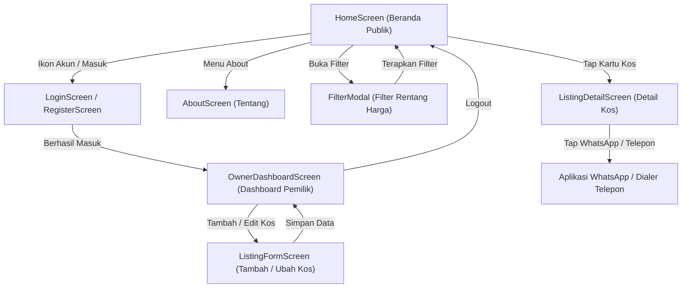

# Arsitektur KosFinder

Dokumen ini mendefinisikan arsitektur sistem, struktur navigasi, skema database, konfigurasi, alur rilis, dan dependensi untuk aplikasi **KosFinder**.

---

## 1. Komponen Aplikasi & Pola Arsitektur (Screen – Provider – Repository – Supabase)

Arsitektur menggunakan pola berlapis terpisah (*Layered Architecture*) yang sederhana dan modular:

```text
[ Screen (UI) ] <---> [ Provider (State) ] <---> [ Repository (Data) ] <---> [ Supabase SDK / Backend ]
```

1. **Screen (Presentation Layer):**
   * **Tugas:** Menampilkan widget UI, menangani input pengguna, dan me-render perubahan state dari Provider.
   * **Komponen & Story:**
     * `HomeScreen` (*Slice 3, 4, 5*): Menampilkan daftar kartu kos publik (`created_at DESC`), search bar, filter bottom sheet, tombol About, dan navigasi ke login pemilik.
     * `ListingDetailScreen` (*Slice 3, 5*): Menampilkan rincian teks lengkap kos dan tombol aksi WhatsApp / Telepon.
     * `AboutScreen` (*Kebutuhan Proyek*): Menampilkan profil pengembang (`2415051059 - Syaeful Darmawan`).
     * `LoginScreen` & `RegisterScreen` (*Slice 2*): Formulir autentikasi pemilik kos via email & password.
     * `OwnerDashboardScreen` (*Slice 2, 5*): Menampilkan daftar kos milik pemilik, toggle ketersediaan, tombol tambah/edit/hapus, dan logout.
     * `ListingFormScreen` (*Slice 2*): Form tambah/edit kos dengan validasi nomor WhatsApp dan panjang fasilitas (maks 200 karakter).

2. **Provider (State Management Layer):**
   * **Tugas:** Mengelola business logic dan reactive state berbasis `ChangeNotifier`, serta memicu render ulang UI (`notifyListeners()`).
   * **Komponen & Story:**
     * `AuthProvider` (*Slice 2*): Menangani state autentikasi (login, register, logout, session check).
     * `ListingProvider` (*Slice 3, 4, 5*): Menangani state daftar kos publik, pencarian teks, dan filter harga.
     * `OwnerListingProvider` (*Slice 2, 5*): Menangani state CRUD kos milik pemilik dan toggle ketersediaan ("Tersedia"/"Penuh").

3. **Repository (Data Access Layer):**
   * **Tugas:** Mengabstraksi komunikasi data ke Supabase, pemetaan model DTO/Entity, serta sanitasi nomor kontak.
   * **Komponen & Story:**
     * `AuthRepository` (*Slice 2*): Memanggil API Supabase Auth (`signUp`, `signInWithPassword`, `signOut`).
     * `ListingRepository` (*Slice 1, 2, 3, 4, 5*): Menjalankan query PostgreSQL ke tabel `listings` (fetch publik, filter harga, search teks, fetch milik owner, insert, update, delete).

4. **Supabase (Backend / BaaS):**
   * **Tugas:** Menyediakan Supabase Client, autentikasi berbasis JWT, penyimpanan database PostgreSQL, dan penegakan otorisasi via RLS (*Slice 1*).

---

## 2. Daftar Layar & Alur Navigasi



---

## 3. Rencana Database & Aturan Akses

Tabel utama: **`listings`**

| Kolom | Tipe Data | Keterangan & Batasan |
| :--- | :--- | :--- |
| `id` | `UUID` | Primary Key, `DEFAULT gen_random_uuid()` |
| `owner_id` | `UUID` | Foreign Key ke `auth.users(id)` ON DELETE CASCADE, NOT NULL |
| `name` | `VARCHAR(150)` | Nama kos, NOT NULL |
| `price_per_month` | `BIGINT` | **Angka murni** (Rupiah), NOT NULL, `CHECK (price_per_month > 0)` |
| `type` | `VARCHAR(20)` | Tipe kos: `'Putra'`, `'Putri'`, atau `'Campur'`, NOT NULL |
| `address` | `TEXT` | Alamat / area di Singaraja, NOT NULL |
| `facilities` | `VARCHAR(200)` | Rincian fasilitas (1-200 karakter), NOT NULL |
| `whatsapp_number` | `VARCHAR(20)` | Nomor kontak lokal (`08...`, 10–15 digit), NOT NULL |
| `is_available` | `BOOLEAN` | Ketersediaan: `true` (Tersedia), `false` (Penuh), DEFAULT `true` |
| `created_at` | `TIMESTAMPTZ` | Waktu dibuat, DEFAULT `now()`, NOT NULL |
| `updated_at` | `TIMESTAMPTZ` | Waktu diperbarui, DEFAULT `now()`, NOT NULL |

### Relasi & Aturan Akses (Row Level Security - RLS):
* **Relasi:** Many-to-one (`listings.owner_id` -> `auth.users.id`).
* **Aturan Akses (RLS):**
  * **Melihat (SELECT):** Terbuka untuk umum / publik (`anon` dan `authenticated`). Kos penuh tetap dapat dibaca.
  * **Menambah (INSERT):** Hanya pemilik terautentikasi (`authenticated`), wajib `owner_id == auth.uid()`.
  * **Mengubah (UPDATE):** Hanya pemilik kos bersangkutan (`auth.uid() == owner_id`).
  * **Menghapus (DELETE):** Hanya pemilik kos bersangkutan (`auth.uid() == owner_id`).

---

## 4. Cara Konfigurasi (`--dart-define`)

Kredensial Supabase dibaca langsung dari environment compile-time Flutter, bukan ditulis di dalam kode (*no hardcoded keys*):

```dart
class AppConfig {
  static const supabaseUrl = String.fromEnvironment('SUPABASE_URL');
  static const supabaseAnonKey = String.fromEnvironment('SUPABASE_ANON_KEY');
}
```

* **Menjalankan Aplikasi (Development / Testing):**
  ```bash
  flutter run --dart-define=SUPABASE_URL=https://<project-ref>.supabase.co --dart-define=SUPABASE_ANON_KEY=<public-anon-key>
  ```

---

## 5. Cara Rilis (Build APK & GitHub Release)

1. **Build APK Release:**
   ```bash
   flutter build apk --release --dart-define=SUPABASE_URL=https://<project-ref>.supabase.co --dart-define=SUPABASE_ANON_KEY=<public-anon-key>
   ```
   * File hasil build: `build/app/outputs/flutter-apk/app-release.apk`.

2. **Publikasi ke GitHub Release:**
   * Buat git tag baru:
     ```bash
     git tag -a v1.0.0 -m "Release MVP KosFinder v1.0.0"
     git push origin v1.0.0
     ```
   * Buat Release di GitHub dan lampirkan `app-release.apk` sebagai binary asset.

---

## 6. Daftar Package & Kebutuhan Story

Hanya package esensial yang digunakan untuk menjaga kesederhanaan (KISS):

1. **`provider`**
   * *Alasan:* State management sederhana, resmi direkomendasikan Flutter, tanpa boilerplate berlebih.
   * *Story:* Slice 2 (Auth/Owner State), Slice 3 (Public Listings State), Slice 4 (Filter & Search State).
2. **`supabase_flutter`**
   * *Alasan:* Client resmi Supabase untuk otentikasi akun pemilik, query database PostgreSQL, dan integrasi RLS.
   * *Story:* Slice 1 (Koneksi Backend), Slice 2 (Auth & CRUD), Slice 3 & 4 (Fetch & Filter Data), Slice 5 (Update Ketersediaan).
3. **`url_launcher`**
   * *Alasan:* Membuka tautan eksternal WhatsApp (`https://wa.me/62...`) dan panggilan telepon lokal.
   * *Story:* Slice 3 (Fitur Hubungi Pemilik).
4. **`intl`**
   * *Alasan:* Pemformatan angka `price_per_month` ke format mata uang Rupiah (`Rp xxx.xxx`) secara konsisten.
   * *Story:* Slice 3 & 5 (Kartu Kos & Halaman Detail).
